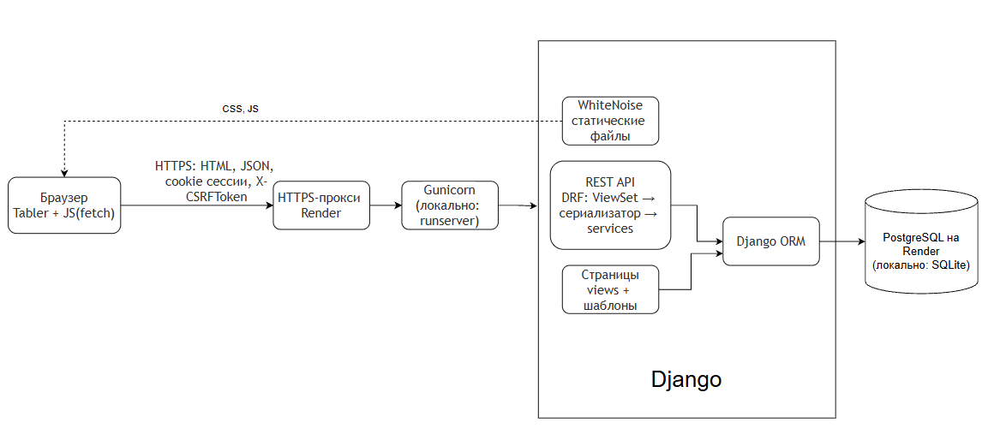

# Архитектура

## Компоненты

| Компонент | Где находится | Что делает |
|---|---|---|
| Браузер | компьютер пользователя | показывает страницы на Tabler, скрипты `api.js`, `app.js`, `library.js` отправляют запросы к API и обновляют страницу без перезагрузки |
| HTTPS-прокси Render | Render | принимает HTTPS, передаёт запрос в Gunicorn с заголовком `X-Forwarded-Proto: https` |
| Gunicorn | Web Service на Render | запускает Django через WSGI (`config.wsgi:application`) в нескольких рабочих процессах. Локально вместо него используется `runserver` |
| WhiteNoise | middleware Django | отдаёт файлы из `staticfiles/`, собранные командой `collectstatic` |
| Страницы Django | `accounts/views.py`, `templates/` | отдают HTML-страницы; доступ только после входа (`@login_required`) |
| REST API | `accounts/views.py`, `serializers.py`, `services.py` | проверяют права, данные и бизнес-правила, возвращают JSON |
| Django ORM | `accounts/models.py` | переводит операции с моделями в SQL-запросы |
| База данных | Render Postgres / файл `db.sqlite3` | хранит данные. Локальная SQLite и облачная PostgreSQL — разные базы, данные между ними не переносятся |

## Прохождение запроса (пример: выдача учебника)

1. Методист на странице `/library/` нажимает «Выдать».
2. `library.js` вызывает `apiRequest()` из `api.js`: `POST /api/loans/{id}/issue/`. Браузер прикладывает cookie сессии, скрипт — CSRF-токен в заголовке `X-CSRFToken`.
3. На Render запрос проходит HTTPS-прокси и Gunicorn и попадает в Django.
4. Маршрутизатор DRF (`DefaultRouter` в `accounts/urls.py`) передаёт запрос в `BookLoanViewSet.issue`.
5. Проверка прав: `IsAuthenticated` (вход выполнен) и `IsMethodologist` (пользователь в группе «Методист»). Иначе ответ 403.
6. `get_object()` ищет заявку среди доступных пользователю. Чужая заявка для студента не найдётся: ответ 404.
7. `services.change_loan_status()` в одной транзакции блокирует заявку и учебник, проверяет допустимость перехода и остаток, уменьшает число свободных экземпляров, меняет статус и записывает событие в историю. При любой ошибке транзакция откатывается целиком.
8. Ответ JSON возвращается в браузер. Скрипт показывает сообщение и заново загружает список, карточку и историю из API.

## Границы взаимодействия

- Браузер не обращается к базе данных напрямую. Все изменения проходят через API и серверные проверки, поэтому проверку нельзя обойти ручным HTTP-запросом.
- Аутентификация общая для страниц и API: сессия Django (`SessionAuthentication`). Изменяющие запросы дополнительно защищены CSRF-токеном.
- Секреты (ключ Django, адрес базы данных) хранятся в переменных окружения, а не в коде.
- Статические файлы в режиме эксплуатации отдаёт WhiteNoise из `staticfiles/`. Эта папка создаётся при каждой сборке и в git не хранится.
- Диск веб-сервиса на Render временный: всё, что должно сохраняться, хранится в PostgreSQL.
