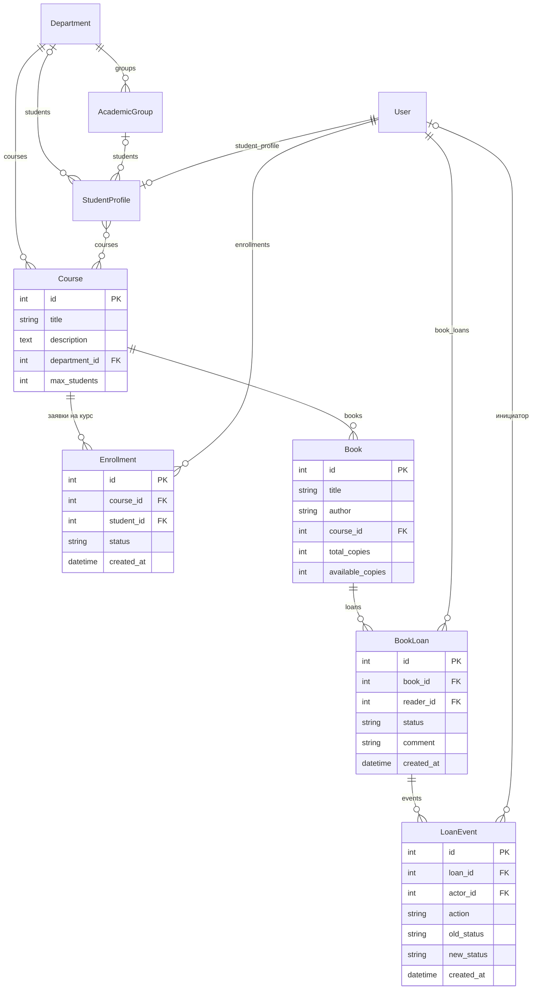

# База данных

Все модели находятся в `accounts/models.py`. Пользователи и группы — стандартные модели Django `auth.User` и `auth.Group`; роль методиста — это группа с названием «Методист».

## Схема моделей

## Сущности

| Модель | Назначение | Ключевые поля | Связи и удаление |
|---|---|---|---|
| `Department` | факультет (институт) | `name` | — |
| `Course` | учебный курс | `title`, `description`, `max_students` — число мест | `department` → Department, CASCADE |
| `AcademicGroup` | учебная группа | `name` | `department` → Department, CASCADE |
| `StudentProfile` | профиль студента | — | `user` → User (один к одному), CASCADE; `department`, `academic_group` — SET_NULL; `courses` — многие ко многим с Course |
| `Enrollment` | заявка на запись на курс | `status`: `pending` / `approved` / `rejected`; `created_at` | `course` → Course, PROTECT (курс с заявками не удаляется); `student` → User, CASCADE |
| `Book` | учебник по курсу | `total_copies` — всего экземпляров, `available_copies` — свободно сейчас | `course` → Course, PROTECT |
| `BookLoan` | заявка на выдачу учебника (основная сущность СРС №7) | `status`: `requested` / `issued` / `returned` / `cancelled`; `comment`; `created_at` | `book` → Book, PROTECT; `reader` → User (владелец), CASCADE |
| `LoanEvent` | событие истории заявки | `action`: `created` / `updated` / `issued` / `returned` / `cancelled`; `old_status`, `new_status`, `created_at` | `loan` → BookLoan, CASCADE; `actor` → User (инициатор), SET_NULL |

## Ограничения целостности

- Поля `max_students`, `total_copies`, `available_copies` имеют тип `PositiveIntegerField`: база данных не примет отрицательное значение.
- `PROTECT` у `Enrollment.course`, `Book.course` и `BookLoan.book` не даёт удалить курс или учебник, на которые есть заявки.
- Изменение статуса заявки на учебник и числа свободных экземпляров выполняется в одной транзакции (`accounts/services.py`), поэтому эти данные не расходятся.
- Записи `LoanEvent` создаются только сервером, через API их нельзя изменить или удалить.

## Миграции

| Миграция | Что добавляет |
|---|---|
| `0001_initial` | Department, Course, StudentProfile |
| `0002_course_description` | поле описания курса |
| `0003_academicgroup_studentprofile_academic_group` | учебные группы |
| `0004_course_max_students_enrollment` | число мест на курсе и заявки на курсы (ПЗ №7) |
| `0005_book_bookloan_loanevent` | учебники, заявки на выдачу, история (СРС №7) |

Команда `python manage.py showmigrations accounts` показывает, какие миграции применены к текущей базе. Локальная SQLite (`db.sqlite3`) и PostgreSQL на Render — разные базы: миграции и тестовые данные применяются к каждой отдельно.
